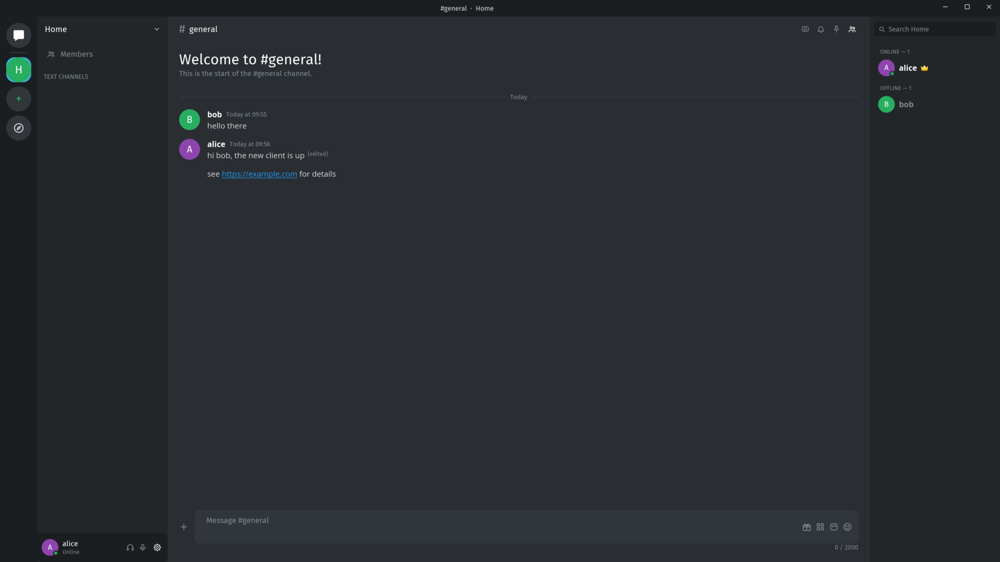
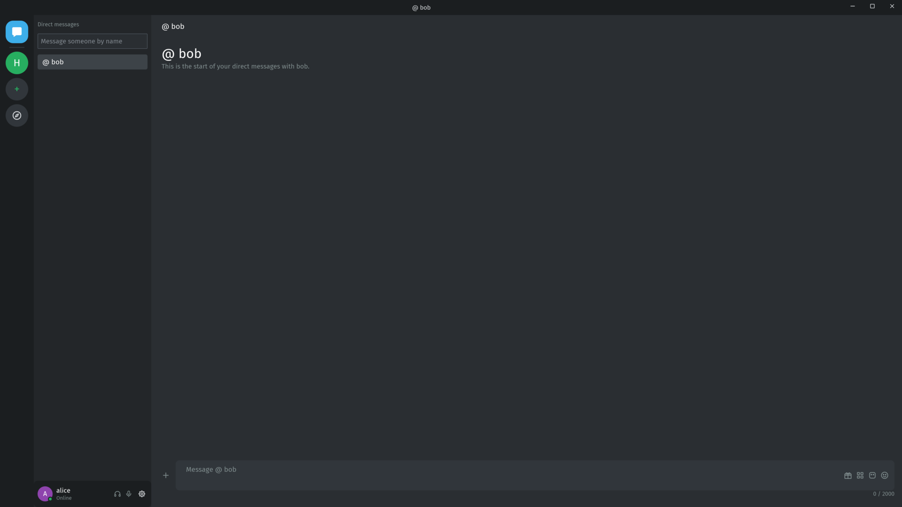
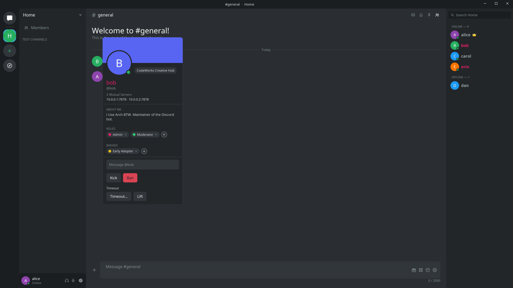
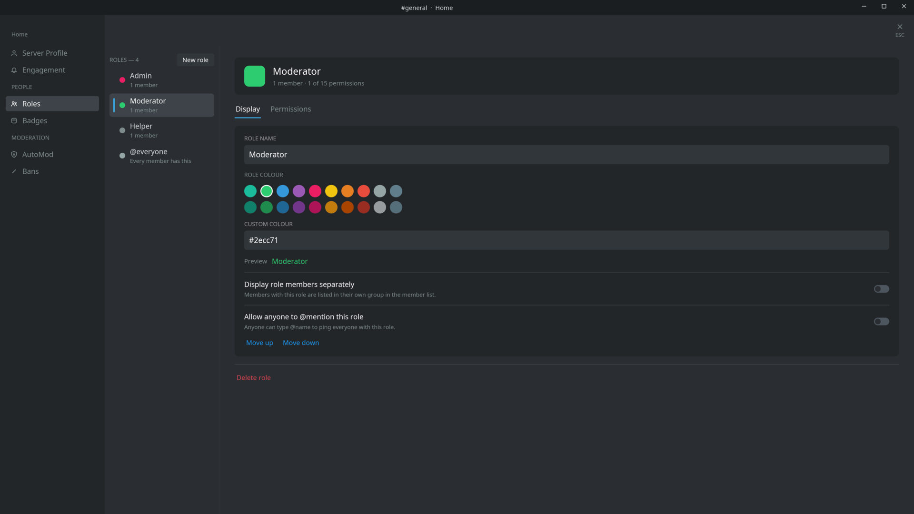
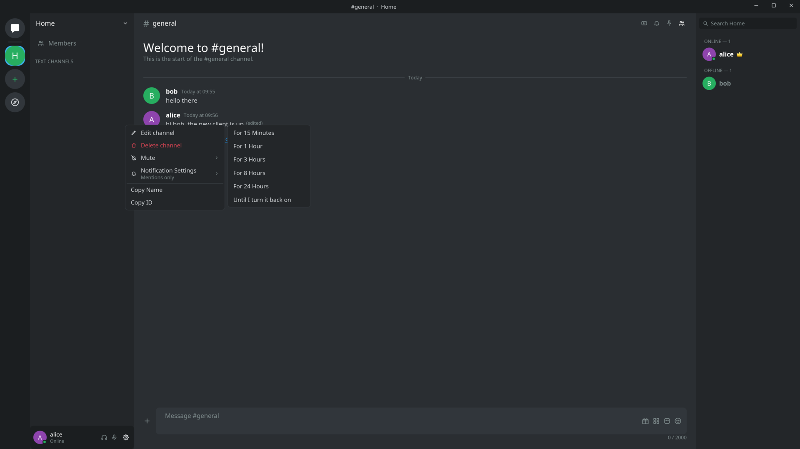
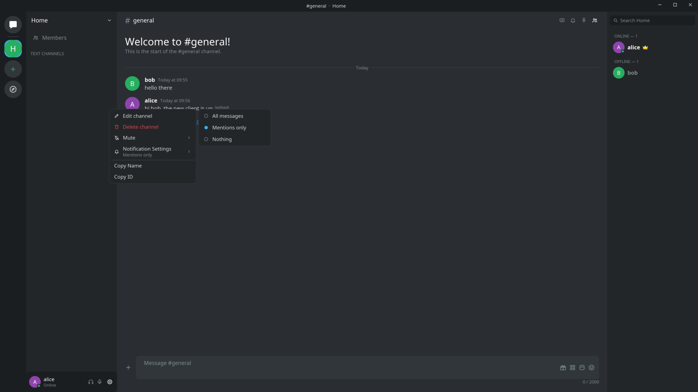
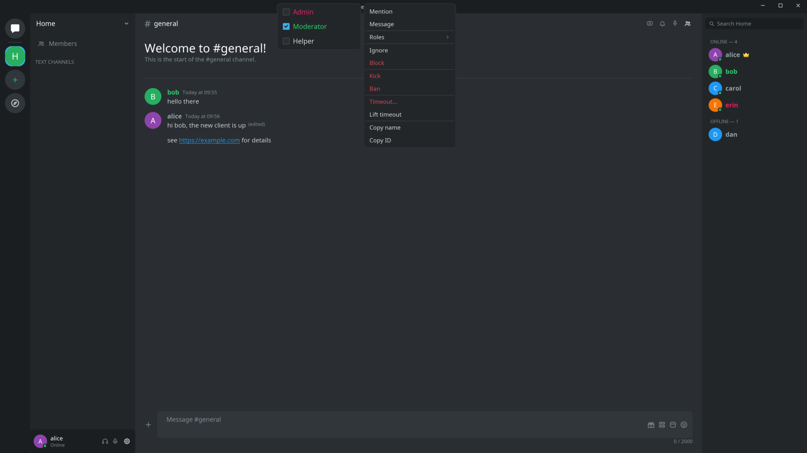
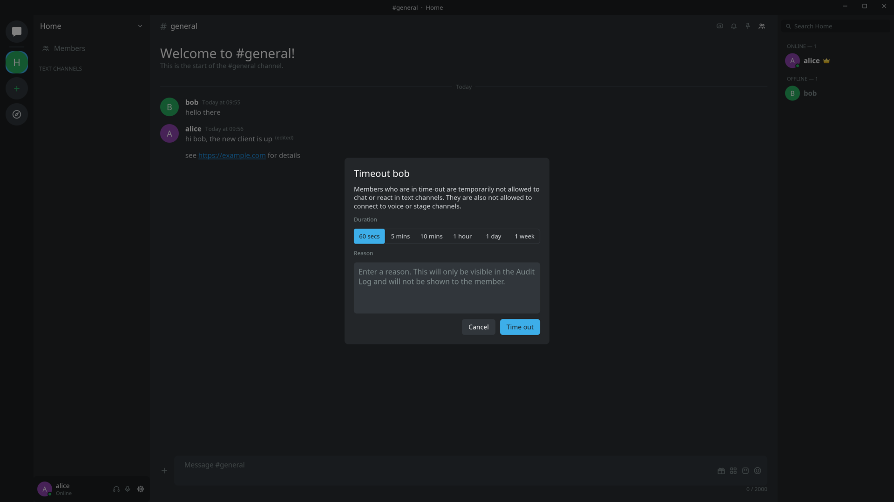
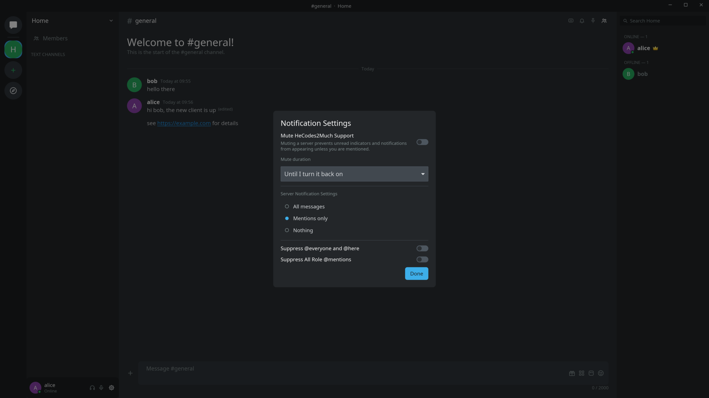
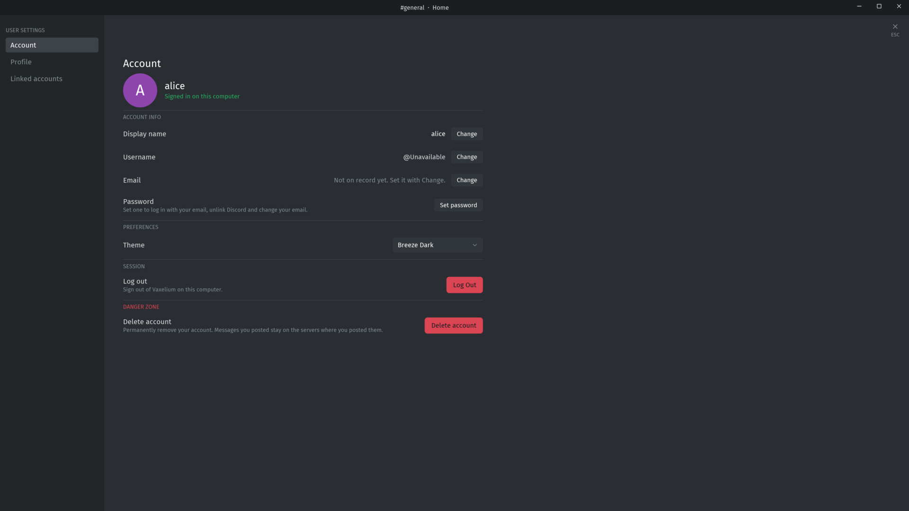

# Vaxelium

A small chat system written in Rust: an auth service, chat
servers, and a desktop GUI client (built with Iced, in Rust).

## Layout

```
common/   shared wire protocol (auth and chat messages, newline-delimited JSON)
auth/     auth service: owns all accounts and login sessions (SQLite + Argon2)
server/   chat server: channels, messages, presence (SQLite); serves the web client (web/)
xtask/    development tasks: `cargo xtask dev` runs everything locally, `cargo xtask web` builds the web client
client/   desktop and web GUI client (Iced), a separate private repository cloned here (see below)
```

The crates are their own repositories, linked here as git submodules. Clone with
submodules:

```
git clone --recursive git@github.com:Vaxelium/Vaxelium.git
```

If you already cloned without it, run `git submodule update --init --recursive`.
Each crate also builds on its own from its repository.

The client is private, so it isn't part of this repository. To build the web client,
clone the client repository into `client/` here (it's git-ignored). `cargo xtask web`
then builds it from there.

The crates' latest code is on each repository's main branch:

- [common](https://github.com/Vaxelium/common/tree/main)
- [auth](https://github.com/Vaxelium/auth/tree/main)
- [server](https://github.com/Vaxelium/server/tree/main)
- [client](https://github.com/Vaxelium/client/tree/main)

One account works on every chat server. The chat servers do not store
accounts. They ask the auth service who a session token belongs to.

## Running

Start three things, each in its own terminal.

1. The auth service. Usage is `auth [ADDR] [DB_PATH]`; the defaults are
   `127.0.0.1:7900` and `auth.db`:

   ```sh
   cargo run -p auth
   ```

2. One or more chat servers. Usage is `server [ADDR] [DB_PATH] [AUTH_ADDR]`;
   the defaults are `127.0.0.1:7878`, `vaxelium.db` and `127.0.0.1:7900`:

   ```sh
   cargo run -p server -- 127.0.0.1:7878 vaxelium.db 127.0.0.1:7900
   cargo run -p server -- 127.0.0.1:7879 second.db 127.0.0.1:7900   # optional second server
   ```

3. The GUI client. On Linux it needs WebKitGTK 4.1 (`webkit2gtk-4.1`) installed:

   ```sh
   (cd client && cargo run)
   ```

Each chat server also serves a web client: the desktop client compiled for the browser, so it looks
and works the same. Build it once (and again after changing the client), then open
`http://127.0.0.1:7880` for a server on `127.0.0.1:7878`:

```sh
sudo pacman -S rust-wasm binaryen                            # on Arch; elsewhere: rustup target add wasm32-unknown-unknown
cargo install wasm-bindgen-cli --version 0.2.130 --locked    # the version in Cargo.lock
cargo xtask web
```

By default the web client is on the first port past the server (or past a group of servers started
together). Set `VAXELIUM_WEB_ADDR=host:port` to choose it, or `off` to turn it off. It is plain HTTP,
so put it behind an HTTPS proxy before using it over the internet. A browser can only reach the
server that served the page, so the web client works with that server only: no other servers, no
finding servers on the network, and no direct messages with people on other servers. Logins and
settings are kept in the browser.

The client finds the auth service at `127.0.0.1:7900`. To use another one, set
`VAXELIUM_AUTH=host:port` before starting the client.

Settings can also go in a `.env` file in the folder you start from. Copy `.env.example` to
`.env` to see the options. A setting already set in the shell wins over `.env`.

Messages and channels are stored in each chat server's SQLite database, so they
survive restarts. Accounts are in the auth database.

## Getting started

1. **Log in or register** with your email and password. Registering also asks
   for a display name. Passwords must be at least 8 characters. This is the
   only login; you don't enter a server here.
2. **Add a server**: click **+** in the server rail, give the server a name and
   its address (blank means `127.0.0.1:7878`). Your account joins it straight
   away. The server list is saved between runs.
3. Click a server's icon in the rail to switch to it. Your account works on
   every server you add.

Your login lasts until you log out, so after a restart you log in again.

## Using the client

The layout is a server rail on the far left, the channel
sidebar with your user bar at the bottom, the channel header on top, and the
online member list on the right.

- **Channels**: click one in the sidebar to switch. A white dot means that
  channel has new messages you haven't looked at yet.
- **Create channel**: type a name in the sidebar box and press Enter. Channels
  are created on demand.
- **Messages**: type in the bottom bar and press Enter. Consecutive messages
  from the same person are grouped under one header, and date dividers appear
  between days. Hover a message to see its exact time.
- **Members**: the right panel lists everyone currently online.
- **Menus**:
  - Click the server's name at the top of the channel sidebar, or right-click
    its icon in the rail: Create channel, Copy server address, Hide/Show member
    list, Log out. The rail menu also has Remove server.
  - Right-click a channel: Mark as read (when it has unread messages) and Copy
    channel name.
  - Right-click a user's name in a message or the member list: Mention (adds
    `@name` to the message box) and Copy name.
  - Click **More** in the bottom-left user bar: Copy my name and Log out.
- **Log out**: ends your session on the auth service and returns to the login
  screen.
- Channels `#general` and `#random` exist at startup. Channel names are
  lowercased, and may contain letters, digits, emoji and other symbols. Spaces are removed.

### Screenshots

| | |
| --- | --- |
| **Chat**<br> | **Direct messages**<br> |
| **Member profile card**<br> | **Roles page**<br> |
| **Channel menu: Mute**<br> | **Channel menu: Notification Settings**<br> |
| **Member menu: Roles**<br> | **Timing out a member**<br> |
| **Server Notification Settings**<br> | **Settings**<br> |

## Protocol

### Auth service

Send one JSON line per request to the auth service. It replies with one line.

```json
{"type":"register","name":"alice","email":"alice@example.com","password":"correct-horse"}
{"type":"login","email":"alice@example.com","password":"correct-horse"}
{"type":"verify","token":"..."}
{"type":"logout","token":"..."}
```

Replies are `session` (with `token` and `name`), `verified`, `logged_out`, or
`error`.

### Chat servers

Each line is one JSON object with a `type` field. The first message on a
connection must be `connect`, carrying a session token from the auth service:

```json
{"type":"connect","token":"..."}
{"type":"join","channel":"general"}
{"type":"say","text":"hello"}
```

The server answers with `welcome`, or with `error` and closes the connection.
After `welcome` it streams `message` and `system` events for the channel the
client is in, plus `joined` (with up to 200 messages of history).

## Licence

The auth service, the chat server and the shared protocol (`auth/`, `server/`,
`common/`, and the scripts and docs in this repository) are under the GNU GPL v3. See
[LICENSE](LICENSE).

The client (`client/`) is under the MIT licence. See [its LICENSE](https://github.com/Vaxelium/client/blob/main/LICENSE).